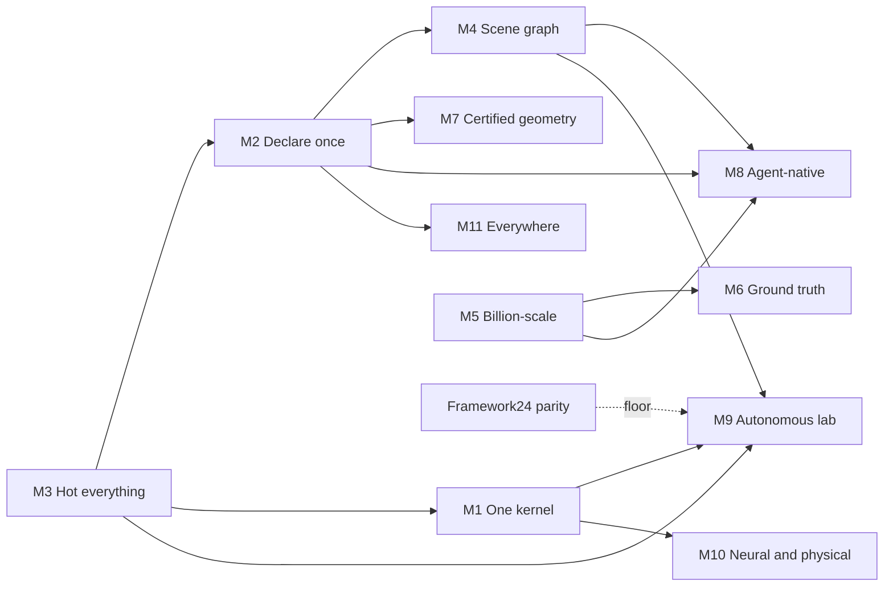

# MOONSHOT — IntrinsicEngine as a living geometry laboratory

> **Status:** vision proposal, 2026-10-27. Not a task, an authorization or a result.
> Numbers under *Today* come from the repository at `83e42148a` and name their source.
> Every *Target* is a hypothesis to test, not a claim. Any part of this plan enters
> the engine by the usual route: vision item → ADR → phased task → tests, telemetry
> and rollback gate.

## The questions

1. "what would be an absolute moonshot to improve the engine? Assume unlimited dev resources and 12 months. use many tokens, be ambitious. Let it rip."
2. "Write it to MOONSHOT.md"

**Goal served:** the mission in `AGENTS.md` §1: "a modular, high-performance, scientifically
rigorous graphics and geometry engine". Framework24 convergence (`REVIEW-004`) is the
**floor** this plan clears first, in parallel with the rest. The plan does not skip it.

---

## 1. The moonshot in one paragraph

In twelve months, IntrinsicEngine becomes the place where geometry questions get answered.
A person or an agent asks a question in plain language. The engine builds a typed,
differentiable and versioned computation over data with billions of elements and shows the
answer at interactive rates. It can trace every number on screen to its origin. Overnight it
improves its own algorithms against a sealed benchmark arena and records what it learns as
reviewed claims. It is not a viewer with operators bolted on. It is a laboratory and a
measuring instrument at the same time.

---

## 2. Demo day, month 12

It is October 2027. A researcher opens the Sandbox on one workstation of today's class (one
RTX 4090).

1. **Open.** They drop in a terrestrial laser scan of a factory hall (2 billion points) and the
   plant's CAD model (400 million triangles). The first pixels appear within 2 seconds. Full
   detail streams in while they orbit at 60 Hz. Picking one point is exact at every zoom
   level. *(M5)*
2. **Ask.** "Register the scan to the CAD. Show me every pipe surface that deviates by more
   than 3 mm, and how sure you are."
   - The agent builds a graph of typed operations: subsample, normals, coarse alignment,
     robust registration, signed distance, threshold, uncertainty.
   - It shows the graph as a proposed *branch*, with a preview diff, before anything touches
     the main scene. *(M8, M4)*
3. **Tweak.** They drag the normal-estimation radius. Only the tiles whose neighbourhoods
   change are recomputed. The deviation colormap updates in under 100 ms. *(M4, M1)*
4. **Ask why.** They click a red pixel. The inspector answers:
   - the value is 4.1 ± 0.3 mm, from registration iteration 37, with a normal radius of 12 mm;
   - the kernel ran on Vulkan and agreed with the CPU reference within the method's declared
     parity tolerance;
   - it also names the code revision and the input's content hash. *(M4, M6, M7)*
5. **Fit, don't guess.** "Choose the robust-kernel scale that minimizes the deviation on the
   flange region." Gradients flow through the differentiable registration kernel. Forty steps
   later, the parameter is in the graph as a recorded node that can be undone. *(M1, M10)*
6. **Branch and compare.** Two remeshing strategies for the CAD side run in parallel branches.
   A structural, numeric and visual diff compares them, and one is merged. *(M4, M6)*
7. **Share.** One click exports three things *(M11, M9)*:
   - a Python notebook that reproduces the session headless, bit for bit;
   - a browser link where a colleague orbits the same 2-billion-point scene in WebGPU;
   - a draft ARA claim with sealed evidence.
8. **Overnight.** The co-scientist runs 400 variants of the normal estimator against the
   Geometry Arena's frozen tasks. By morning:
   - two variants have passed the correctness gates;
   - both beat the best published baseline on partially overlapping scans, under the
     preregistered protocol;
   - each waits as a method pull request with a CPU reference, parity tests, a benchmark and a
     limitations section. *(M9)*

Every step already exists in some fragment: scan import, normals, CPD registration, property
visualization, the MCP lane, undo/redo, the ARA ledger and the co-scientist prototype. The
moonshot turns them into one system that works at this scale and this speed, with this much
evidence.

---

## 3. Where we start

### Already exceptional (keep and build on)

| Asset | Evidence today |
| --- | --- |
| **Geometry kernel** | `src/geometry`: about 88k lines in 252 files. It covers: <ul><li>a halfedge mesh with adaptive remeshing, Booleans, Catmull–Clark and √3 subdivision, and discrete exterior calculus (DEC);</li><li>heat, vector-heat and signed-heat geodesics;</li><li>BFF, harmonic and UV-atlas parameterization;</li><li>multicut segmentation and Coherent Point Drift (CPD) registration, including a Nyström E-step;</li><li>LOP and progressive Poisson sampling;</li><li>robust predicates and sparse solvers.</li></ul> |
| **GPU foundation** | Vulkan sits behind a backend-neutral RHI, with bindless resources, buffer device addresses and a frame graph. It provides: <ul><li>GPU-driven culling with a depth pyramid (HZB), light clusters and a linear BVH (LBVH);</li><li>a compute-primitive library: radix sort, scan, compaction, segmented reduce and sparse conjugate gradient;</li><li>42 compute shaders, among them GPU backends for K-Means, LOP, the CPD E-step, farthest-point sampling, normals and property filters.</li></ul> |
| **One apply path** | Config, UI and the MCP agent lane reach the same validated commands with undo/redo (ADR 0029, `docs/architecture/agent-control-lane.md`). |
| **Scientific discipline** | <ul><li>A method workflow that starts from a CPU reference and checks backend parity.</li><li>Experiment preflight and review by a different model.</li><li>An ARA ledger with 125 claims that state their falsification criteria.</li></ul> |
| **Test depth** | 5,917 CPU tests and 168 Vulkan readback smokes passed on the current tree (UI-083 gates, 2026-10-27). About 278k lines of tests. |
| **Velocity** | 5,766 commits since 2025-11-20. |

### What caps everything

| Ceiling | Evidence today |
| --- | --- |
| **Glue tax** | UI-083 slice 4 (per-arrow length and color for vector fields) touched **29 files**, tests included: <ul><li>recipe, validation and serialization;</li><li>packet, GPU record and renderer resolution;</li><li>extraction caches, editor model, command, snapshot and panel;</li><li>agent operations with a hand-maintained 17-key allowlist.</li></ul> The independent review found both blocking bugs at seams between these parts: the UI offered properties that extraction then rejected, and the agent path ignored unknown keys. `src/runtime/Editor` alone is about 50k lines. Every method also fills in the seven-field engine-integration matrix by hand. |
| **Iteration tax** | <ul><li>Clean build of the `ExtrinsicRuntime` closure: median **333 s**.</li><li>Interface edits: medians of **23–44 s**.</li></ul> Both are local, descriptive observations (ARA C97). The interface (BMI) of one snapshot module is 28 MB; 14.7 s of its 16.7 s compile is AST serialization (C98). |
| **Truth tax** | Every GPU backend is a hand-written twin of its CPU reference, and hand-written parity tests prove them equal. Every claim needs an evidence packet assembled by hand. Rendering correctness is checked by readbacks at a few sampled pixels, never against a reference image. |
| **Scale ceiling** | All geometry stays resident in memory. There are no mesh shaders and no ray tracing: the RHI binding contract has an `AccelerationStructure` value with nothing behind it. There is no out-of-core streaming, no Gaussian splats and no sparse volumes. |
| **Reach ceiling** | <ul><li>Linux with Vulkan only.</li><li>No Python bindings.</li><li>No headless batch CLI yet (`RUNTIME-282`).</li><li>Only one agent client at a time.</li></ul> |
| **Product floor** | All six Framework24 golden workflows are still `Open` (`docs/product/framework24-convergence.md`). |

---

## 4. The thesis: cut the taxes, then spend the dividend

What limits the engine is not a missing feature. It is the **price of each feature**. A rough
model:

> output per month ≈ people × 1 / (cost per feature) × 1 / (iteration time) × 1 / (cost of truth)

With "unlimited developers", people is the only factor that grows. Coordination costs grow
faster than linearly in a 50k-line glue layer. On today's foundations, unlimited developers
would mostly produce merge conflicts in `Runtime.Editor`.

A moonshot that only adds capability would multiply the taxes. So the program has a strict
order:

- **Act I — Substrate.** Cut each of the three taxes by an order of magnitude.
- **Act II — World.** Turn the scene into a versioned computation that scales to billions of
  elements.
- **Act III — Truth.** Make every pixel and every number defensible.
- **Act IV — Intelligence.** Make the engine a collaborator and a scientist.
- **Act V — Reach.** Run everywhere the work happens.

Eleven pillars (M1–M11) carry the five acts. Each pillar names:

- what exists today;
- the moonshot;
- the existing work it builds on;
- a target at month 12;
- a **kill criterion**: the point where we stop and fall back.

---

## Act I — Substrate

### M1. One kernel, every backend, differentiable by default

**Today.** There are 42 GLSL compute shaders, each written by hand next to a C++ reference.
Parity is proven method by method, and nothing has automatic gradients. `GRAPHICS-123` (Slang
pilot) is deliberately narrow: one kernel, no migration.

**Moonshot.**

- **One source.** Slang becomes the single language for data-parallel kernels and shaders.
  - Each kernel is written once and compiled to SPIR-V (Vulkan) and to C++ (a CPU backend).
  - Metal and WGSL targets follow later (M11).
- **Two oracles, kept apart on purpose.**
  - The hand-written C++ CPU reference stays the *specification*. It catches errors in the
    algorithm.
  - The same Slang source compiled for both CPU and GPU catches errors in the backend: races,
    precision loss, driver and compiler behaviour. Example: the NVIDIA compiler cancelled a
    common factor in UI-083's colormap normalization until the shader marked it `precise`.
  - A generated kernel is never its own reference.
- **Differentiable by default.**
  - Forward and reverse derivatives come from Slang's automatic differentiation.
  - Adjoint (gradient) buffers are frame-graph resources with explicit lifetimes.
  - Every differentiable kernel gets generated finite-difference gradient checks.
- **Typed slots, zero copies.** Kernels bind to the semantic property slots of the method
  workflow and to the GPU property residency (`RUNTIME-294`, `GRAPHICS-153`). A kernel reads
  `f:centroid` or `v:position` without a converter or a copy.
- **Cost-model dispatch.** Each kernel declares bytes moved, FLOPs and occupancy. Automatic
  CPU/GPU selection uses these numbers and reports the requested and actual backend and any
  fallback, as golden workflow W6 requires.

**Builds on:** `GRAPHICS-123`, `Graphics.ComputeParallelPrimitives`,
`docs/architecture/algorithm-variant-dispatch.md`, the GPU property residency.

**Target (month 12).**

- At least 80 % of compute kernels are written once.
- Adding a GPU backend to an existing CPU method takes at most one day, parity tests included.
- Every differentiable kernel has generated gradient checks.

**Kill criterion.**

- If Slang output stays more than 15 % slower than the hand-written GLSL on the
  compute-primitive suite after tuning, those primitives stay hand-written.
- If the C++ target cannot reproduce floating-point behaviour closely enough for differential
  testing, it is used for gradients only. CPU–GPU parity then stays tied to the hand-written
  reference.

### M2. Declare once: one operation schema generates everything else

**Today.** See the glue tax: one style option took 29 files, and the bugs sat at the seams.

**Moonshot.** Each operation, recipe and setting has exactly **one declaration**. A sketch in
C++26 annotation syntax (the same content could live in a schema file):

```cpp
struct [[=op("vector_field.style"), =undo::single_step, =publishes::recipe]] VectorFieldStyle {
    [[=same_domain, =count_matches_domain, =kinds(Scalar)]]
    std::optional<PropertyRef> Length;
    [[=same_domain, =count_matches_domain, =kinds(Scalar, Vec3, Vec4)]]
    std::optional<PropertyRef> Color;
    Colormap ColorMap = Colormap::Viridis;
    [[=finite, =ordered]] AutoOr<Range<float>> ColorRange = Auto;
};
```

From that one declaration, a generator produces:

- the validated apply path, identical for config, agent and UI;
- the ImGui panel, including readiness states and the reasons a control is disabled
  (`UI-037`, `UI-077`);
- the MCP tool schema, with strict refusal of unknown keys;
- scene serialization, with versioned migration of older files;
- the undo/redo command;
- the Python binding and the CLI flags;
- a reference documentation page;
- **contract tests**:
  - save/load round trip;
  - a refused command leaves no undo step;
  - the candidates the UI offers equal exactly what the validator accepts;
  - UI and agent behave the same.

**The central point:** the UI's list of candidates and the command's validator come from the
**same predicate**. The class of bugs found in UI-083 can then not be written at all.

**Escape hatch.** A hand-written panel can replace the generated one where the design needs
it. The generated validator and the generated tests still apply.

**Target (month 12).**

- A new, fully integrated option takes at most 3 files and one day.
- `src/runtime/Editor` shrinks to at most 25k lines while covering more operations.
- 100 % of MCP tools are generated.

**Kill criterion.** If C++26 reflection is not usable with the pinned toolchain by month 2,
ship a schema compiler that emits C++23 module partitions instead. The design stays the same.

### M3. Hot everything: from an edit to the running Sandbox in two seconds

**Today.** See the iteration tax: 333 s for a clean build of the runtime closure, 23–44 s per
interface edit, and module interfaces (BMIs) of tens of megabytes.

**Moonshot.**

- **Interface diet.**
  - Module interfaces become thin. Implementations sit behind type-erased or pimpl boundaries.
  - Imports needed only by the implementation leave the interfaces (`BUILD-013`, `BUILD-014`).
  - Goal: interfaces of at most 2 MB, and an interface edit rebuilds at most 10 files.
- **Content-addressed action cache.** Local and remote, keyed by verified action digests, and
  shared by CI, every developer and every agent (`CI-012`–`CI-016`, `BUILD-005`, `BUILD-006`).
- **Plugins with hot reload.**
  - Methods, operations, panels and render features become modules that can be reloaded
    behind a versioned ABI.
  - The Sandbox reloads them while it runs and replays the scene graph (M4) to restore its
    state.
- **Shader and kernel hot reload**, backed by a persistent pipeline cache.
- **Faster tests.**
  - Test-impact selection takes seconds: `tools/ci/touched_scope.py` grows into the
    `CI-014`/`CI-018` impact graph.
  - The CPU gate is split into deterministic shards (`CI-015`).
- **Distributed compile workers.**

**Target (month 12).**

| Path | Target |
| --- | --- |
| Edit of a method or panel → running Sandbox | median ≤ 2 s |
| Edit of a core interface | ≤ 30 s |
| Clean build with a warm cache | ≤ 60 s |
| CPU gate, wall time | ≤ 3 min |

**Kill criterion.** If hot reload of C++ modules is unstable with the toolchain, hot-reload only
the method plugins. They are most of the edits.

---

## Act II — World

### M4. The scene is a graph: a live, versioned dataflow

**Today.**

- The scene is ECS entities with properties.
- Commands mutate it, and undo uses snapshots.
- Jobs reject stale results, and CPU and GPU copies of properties stay coherent.
- Entities have stable IDs, and the scene is saved as JSON.
- Derived data records no lineage beyond a command label.

**Moonshot.**

- **A persistent, content-addressed dataflow graph** with four kinds of node:
  - input assets, identified by content hash;
  - operation nodes (from the M2 schemas);
  - parameter nodes;
  - outputs: properties, entities and recipes.
- **Incremental recomputation in two stages.**
  - First, memoization per operation.
  - Then demand-driven recomputation per chunk (spatial tiles, clusters, property chunks).
  - Early cutoff: if a recomputed chunk has the same hash as before, propagation stops there.
- **History is a DAG.**
  - Undo and redo move the head pointer.
  - Branches exist; scene states can be diffed (structurally, numerically and visually) and
    merged.
  - A time slider scrubs through history.
- **Provenance.** Every value can answer "why": which operation, which parameters, which inputs,
  which code revision, which backend, which seed.
- **Collaboration.**
  - Structure and parameters are replicated with a CRDT. Data is stored as immutable,
    content-addressed blobs.
  - Several people and agents edit one scene, live or each on a branch.
- **The ECS stays.** It becomes the materialized view of the head. Graphics still consumes
  extracted snapshots, so the layering table is unchanged.
- **Saving.**
  - A saved scene is the graph plus the blob store, so it is reproducible by construction.
  - Large data uses a binary format (redesign vision §3.8).

**Builds on:** `EditorCommandHistory`, the job service with stale-result rejection, property
coherence, `StableId`, scene serialization.

**Target (month 12).**

- Every mutating operation is a graph node.
- For a local operation on 10M elements, a slider change reaches the screen in at most 100 ms.
- A UI exists for branch, diff and merge.
- Two people and one agent edit one scene together over a LAN.

**Kill criterion.** If incremental recomputation per chunk costs more than it saves for
operations that change topology, keep memoization per operation for those. That still gives
provenance, branches and replay.

### M5. Billion-scale, interactively

**Today.** All data is resident in memory. The GPU-driven pieces (instance culling, HZB, LBVH,
light clusters) are a good start. The cluster hierarchy exists only as an evidence task
(`GRAPHICS-125`, `GEOM-066`, `GEOM-067`).

**Moonshot.**

- **Visibility buffer.** Every pixel stores entity, cluster and primitive, plus barycentric
  coordinates. One mechanism then gives:
  - exact picking;
  - shading of per-element properties for all three domains in one deferred material pass;
  - per-pixel IDs that agents can use (M8).
- **Meshes.**
  - A cluster DAG with continuous level of detail (Nanite-style). The `GRAPHICS-125` evidence
    comes first.
  - Mesh shaders (`VK_EXT_mesh_shader`).
  - Compute-shader rasterization for tiny triangles.
  - Compressed meshlets.
- **Points.**
  - An out-of-core octree (Potree-like) in a chunked, compressed on-disk format.
  - Compute-shader rasterization with 64-bit atomics.
  - EWA and surfel splats (`GRAPHICS-160`).
- **Gaussian splats** as a first-class representation: import, render, select, edit and
  convert.
- **Sparse volumes** (NanoVDB-style) for SDFs, reconstruction and simulation.
- **Hardware ray tracing.**
  - Ray queries give exact picks, shadows and ambient occlusion.
  - Most important for this engine: accelerated geometry queries (closest point, ray cast,
    visibility, generalized winding number) as a backend for geometry methods.
- **Topology on the GPU.** A GPU-resident halfedge structure with parallel local edits (split,
  collapse, flip, halfedge-refinement Catmull–Clark) for remeshing and subdivision at scale.
- **Streaming.**
  - An asynchronous streaming graph with budgets and cancellation.
  - A content-addressed binary asset cache and memory-mapped files.

**Target (month 12).**

- 2B points plus 500M triangles at 60 Hz or more, at 1440p on an RTX 4090, within 12 GB of VRAM.
- The first pixel within 2 s of opening.
- Exact picking at every level of detail.
- Fallback tiers for GPUs without mesh shaders or ray tracing.

**Kill criterion.** If a cluster DAG for arbitrary scanned meshes (non-manifold, high valence)
is still fragile at month 6, ship meshlet culling without continuous LOD. Spend the effort on
points instead, which is where users' largest data is.

---

## Act III — Truth

### M6. Ground truth for every pixel

**Today.** 168 Vulkan readback smokes, which assert a few pixel samples. Beyond that, render
correctness is judged by eye.

**Moonshot.**

- **A reference path tracer** on the same scene graph: deterministic seeds, progressive,
  optionally spectral. It is the oracle for raster lighting, shadows, ambient occlusion and
  transparency.
- **Golden-image CI.**
  - At least 300 scenes, compared with a perceptual metric (FLIP).
  - When a scene fails, an automatic bisection per pass finds where it diverges. This automates
    the `intrinsicengine-vulkan-frame-triage` recipe.
- **Visualization integrity.**
  - The value under the cursor is read back exactly from the property, not decoded from its
    color.
  - Colormaps are tested for perceptual uniformity and colour-blind safety.
  - Tests guarantee that glyphs stay visible and legible.
  - Uncertainty is a first-class visual channel.
  - An inspector shows how any pixel was computed: pass, pipeline, inputs.

**Target (month 12).** Every render feature has a test against the reference. The golden suite
runs on every merge in under 10 minutes on a GPU runner.

### M7. Certified geometry

**Moonshot.**

- **Exact predicates everywhere.** Exact or adaptive predicates throughout
  (`Geometry.RobustPredicates` exists).
- **Exact mesh arrangements** for Booleans and self-intersection repair. Their output is never
  non-manifold and never self-intersecting.
- **Generated property-based and metamorphic tests** for every operator, from its M2 schema:
  - equivariance under rigid motion;
  - invariance under permutation;
  - convergence under refinement;
  - covariance under scaling;
  - with automatic shrinking of failing cases.
- **Continuous fuzzing** of every importer and operator under sanitizers.
- **Differential tests** against external oracles in CI-only builds: CGAL, libigl,
  geometry-central, meshoptimizer. They become production dependencies only by a separate,
  justified decision.
- **Corpus sweeps.** Thingi10K and ABC run through every repair, Boolean, remeshing and
  parameterization operator.

**Target (month 12).**

- Zero crashes and zero invalid outputs across the corpus sweeps.
- Every failure is an explicit diagnostic.
- Metamorphic tests cover 100 % of operators.

---

## Act IV — Intelligence

### M8. Agent-native all the way down

**Today.**

- The MCP lane offers the editor's typed operations, previews, jobs and screenshots.
- A read-only mode exists.
- One client is connected at a time.

**Moonshot.**

- **Every M2 operation is automatically a tool**, validated exactly against its schema.
- **Agents work on branches** of the M4 graph. They propose, and a person merges.
  - Autonomy becomes safe because nothing reaches the head without a merge.
  - Several agents can work at once, which replaces the single-client lock.
- **Semantic queries.** Selection by predicates over properties, topology and space (seed:
  `RUNTIME-280`). The resulting element sets are graph nodes of their own.
- **Visual grounding.** Screenshots carry the visibility buffer's per-pixel IDs. "This region"
  in an image therefore maps to concrete elements.
- **A pair geometer in the editor.** Natural language becomes a proposed operation graph, shown
  as a diff preview. Voice input is optional.
- **An agent evaluation.**
  - 200 geometry tasks in plain language, each with an outcome that can be checked.
  - It runs every night.
  - The agents' success rate is a product metric, next to frame time.

**Target (month 12).**

- At least 85 % task success.
- Median time to a correct graph: 60 s or less.
- No mutation of the head without review.

### M9. The autonomous lab

**Today.**

- `research/coscientist` runs with a mock harness and a Poisson task.
- The method workflow, preflight and the ARA ledger exist.
- Literature research flows from Scholar Inbox to Zotero (review of 2026-10-23).

**Moonshot.**

- **The Geometry Arena.** A sealed, versioned corpus and task suite.
  - Tasks: normals, registration (full and partial overlap), remeshing quality,
    parameterization distortion, reconstruction, segmentation, geodesics, curvature.
  - Each task has frozen metrics, a null arm, positive and negative controls, and external
    baselines.
  - It runs headless at scale (M11 batch) and has a public leaderboard.
- **The co-scientist goes live.**
  - The loop: generate → compile as a hot plugin (M3) → correctness gate → tournament on
    measured results → evolve.
  - Evolutionary search runs over Slang kernels (M1), with measured fitness (AlphaEvolve-style).
  - The prototype's trust boundary stays: the scorer never runs candidate code.
- **Agents follow the same experiment rules as people:**
  - preflight packets;
  - review by another model;
  - frozen plans;
  - reports generated from raw outputs;
  - negative results are kept.
- **From paper to method in 48 hours.** An arXiv paper becomes a method package containing:
  - a CPU reference;
  - parity tests;
  - a benchmark manifest;
  - a limitations section;
  - a reproduction report against the paper's own claims.
- **A weekly literature watch** → triage → pilot candidates, recorded in Zotero and the
  research index.

**Target (month 12).**

- 20 papers reproduced, each with a report. Failed reproductions count.
- At least 3 improvements discovered by the engine beat the best published baseline on an Arena
  task, under a preregistered and reviewed protocol.
- One paper written from the ledger.

### M10. Neural, differentiable and physical

- **Neural fields** (hash-grid SDF and UDF) trained inside the engine on M1's automatic
  differentiation.
- **Splats from images.** Gaussian splats optimized from photographs.
- **Differentiable rendering for inverse problems**: fit shape and material to photographs.
- **Representation algebra.**
  - Typed conversions between mesh, points, SDF or volume, splats and neural fields.
  - Each conversion transfers properties and reports what it loses, following the existing
    loss-aware import pattern.
- **Learned methods are backends, never the only implementation.** They sit behind the rule
  that the CPU reference is the truth.
- **Physics in the loop.**
  - Vulkan backends for SPH, particle-spring and XPBD (`PHYSICS-005`–`007`).
  - IPC contact, which guarantees no intersections.
  - Differentiable simulation for optimizing shapes against physical objectives.

---

## Act V — Reach

### M11. Everywhere the work happens

- **Python.** Zero-copy nanobind bindings, generated from M2, plus a Jupyter widget that streams
  the viewport.
- **Headless.**
  - A headless batch CLI (`RUNTIME-282`).
  - Deterministic view capture (`RUNTIME-281`).
  - A container image for GPU clusters.
- **WebGPU viewer.** Read-only share links to graph snapshots, with streaming level of detail.
- **Windows and macOS.** MoltenVK first. A native Metal backend behind the RHI only if MoltenVK
  blocks a feature tier.
- **OpenXR** for immersive inspection of scans.

**Target (month 12).**

- `pip install` works on three operating systems.
- A 1-billion-point scene opens from a browser link.

---

## 5. Twelve months

### Dependencies



- **M3 and M2 are the critical path.** Every later pillar is cheaper once they land.
- **M5 starts in parallel on day one.** Its long pole is the evidence for the cluster DAG, and
  it depends on nothing in Act I.
- **Framework24 parity runs as its own protected track.** Act IV's research spending does not
  start before the `REVIEW-004` verdict.

### Quarters

| When | Theme | Exit demo |
| --- | --- | --- |
| Weeks 0–4 | Measure and decide | <ul><li>Scorecard baselined.</li><li>ADRs for M1, M2, M4 and M5 accepted or killed.</li><li>Arena v0 frozen.</li><li>Parity squad running.</li></ul> |
| Q1 (months 1–3) | Substrate | <ul><li>The vector-field style re-declared in M2: 29 files become 3 or fewer.</li><li>5 compute primitives written once, with gradients.</li><li>Clean build with a warm cache in 2 minutes or less.</li><li>Hot reload of method plugins.</li><li>Framework24 W1, W2 and W4 accepted.</li><li>Visibility-buffer spike.</li></ul> |
| Q2 (months 4–6) | World | <ul><li>Scene graph v1: memoization per operation, branches, provenance, with the ECS as its view.</li><li>All operations on M2.</li><li>Clusters and mesh shaders.</li><li>1 billion points out of core.</li><li>Picking by ray query.</li><li>Python bindings.</li><li>**`REVIEW-004` verdict.**</li></ul> |
| Q3 (months 7–9) | Truth and intelligence | <ul><li>Path-tracer oracle and golden-image CI.</li><li>Certified Booleans.</li><li>Generated metamorphic tests.</li><li>Co-scientist live on the Arena.</li><li>Nightly agent evaluation.</li><li>Incremental recomputation per chunk.</li><li>Splats.</li></ul> |
| Q4 (months 10–12) | Scale and reach | <ul><li>The billion-scale targets.</li><li>WebGPU links.</li><li>Windows and macOS.</li><li>Collaboration.</li><li>Neural fields and inverse problems.</li><li>**Demo day.**</li><li>The paper.</li></ul> |

---

## 6. Scorecard

| Metric | Today (source) | Month 12 |
| --- | --- | --- |
| Framework24 golden workflows accepted | 0 / 6 (`framework24-convergence.md`) | 6 / 6, by month 6 |
| Files touched to integrate one option fully | 29 (UI-083 slice 4) | ≤ 3 |
| Lines in `src/runtime/Editor` | ≈ 50k | ≤ 25k, covering more operations |
| Clean build of the runtime closure | 333 s median, local (ARA C97) | ≤ 60 s warm, ≤ 5 min cold |
| Rebuild after an interface edit | 23–44 s medians (C97) | ≤ 5 s |
| Edit → running Sandbox (method change) | not measured | ≤ 2 s |
| CPU gate wall time | to be measured | ≤ 3 min |
| Largest interactive scene | not measured (`BENCH-001`) | 2B points + 500M triangles at 60 Hz |
| Compute kernels written once and differentiable | 0 of 42 | ≥ 80 % |
| Render features with a reference-image test | 0 | 100 %, 300+ scenes |
| Thingi10K/ABC sweep: crashes and invalid outputs | not measured | 0 |
| Agent evaluation success | no evaluation | ≥ 85 % |
| Papers reproduced, with reports | — | 20 |
| Improvements discovered by the engine, reviewed | 0 | ≥ 3 |
| Platforms | Linux / Vulkan | Linux, Windows, macOS, Web (viewer), XR |

A *not measured* entry is a baseline task for weeks 0–4, not a zero.

---

## 7. Organization

Unlimited resources move the bottleneck from people to coordination.

- **Squads.**
  - One squad of 5–7 people per pillar, each person working with agents.
  - A protected Framework24 parity squad.
  - A platform squad for CI and builds.
- **Measurement is independent.** An evaluation squad owns the Arena, the agent evaluation and
  the golden images. The people who measure do not build what they measure.
- **Architecture council.** It owns the ADRs and the layering invariants. Any squad may propose
  a decision, and the council decides within a week.
- **Every pillar has** one owner, a kill criterion with a date, and a demo every week.
- **Agents multiply output, and Act I is what lets them scale.** The repository's agent workflow
  (task notes, preflight, review by another model) already works. Smaller changes keep it
  working at ten times the volume.
- **Automate evidence before hiring.** Verification receipts and the evidence graph
  (`CI-012`–`CI-020`, `PROC-031`) must be automatic before headcount grows. Otherwise review
  becomes the new bottleneck.

---

## 8. What we deliberately do not do

- **No game engine.** No gameplay scripting, audio, game networking or asset store.
- **No new scripting language.** Python is the scripting surface.
- **No big-bang rewrite.**
  - Each pillar replaces the old path step by step, behind flags and through the existing
    gates.
  - The old path is deleted once the new one is proven (roadmap: "no compatibility clutter").
- **No weakened guarantees.** The layering table, CPU references as the truth, fail-closed
  behaviour and truthful backend reporting all stay.
- **No neural-only method, no claim without evidence, no Arena result without
  preregistration.**
- **No feature for its own sake.** Every pillar must move a row of the scorecard.

---

## 9. Risks and kill switches

| Risk | Early signal | Response |
| --- | --- | --- |
| Slang is too slow or too immature | The primitive suite is more than 15 % slower after tuning | Keep the hot primitives in GLSL and use Slang everywhere else |
| No usable reflection in the toolchain | Not usable by month 2 | A schema compiler that emits C++23 partitions |
| The incremental graph becomes too complex | Chunk-level memoization costs more than it saves | Memoization per operation only |
| Virtual geometry on messy scans | The cluster DAG is still fragile at month 6 | Meshlet culling without LOD; points first |
| Agent autonomy goes wrong | Any head mutation without review | Branch-only writes, enforced in the engine rather than by prompts |
| Coordination overhead | Merge conflicts or review latency rising | Freeze new pillars and finish Act I first |
| Process overhead at scale | Evidence assembly dominates cycle time | `CI-012`–`CI-020` become priority 0 |
| Portability tiers | MoltenVK lacks mesh shaders or ray tracing | Feature tiers with tested fallbacks; Metal backend if needed |
| **The moonshot eats the product** | `REVIEW-004` has no verdict by month 6 | Pause Act IV research spending until it has one |

---

## 10. The first 30 days

1. **Baseline the scorecard.**
   - Use the `BENCH-001` manifests and the build-measurement manifests.
   - Measure edit-to-Sandbox latency, CPU gate wall time and the largest interactive scene.
2. **ADR: kernel language.** Widen `GRAPHICS-123` into a decision spike.
   - Port five compute primitives and one GPU method (the K-Means assignment) to Slang.
   - Measure them against the GLSL versions.
   - Add generated gradient checks.
3. **ADR: operation schema.** Re-implement the UI-083 vector-field style from one declaration.
   - Count the files.
   - Run the existing tests unchanged against the generated code.
4. **ADR: scene graph and provenance.** Prototype memoization per operation and branches over
   `EditorCommandHistory`, on three operations.
5. **Build bake-off.** `BUILD-005`/`BUILD-006`, plus the first content-addressed cache
   (`CI-016`), with the interface diet applied to the five largest BMIs.
6. **Visibility-buffer spike** and the `GRAPHICS-125` cluster-hierarchy evidence.
7. **Arena v0.**
   - Five tasks with frozen metrics, null arms and controls.
   - Build the engine harness host from `research/coscientist/HARNESS_HOST_TASK.md`.
8. **Framework24 squad.** Start burning down the dependencies of `REVIEW-004`.
9. **Python spike.** nanobind over five operations, with zero-copy property spans.
10. **Agent evaluation v0.** 50 plain-language tasks with checkable outcomes.

---

## Appendix A — Seeds already in the repository

| Pillar | Existing seeds |
| --- | --- |
| M1 | `GRAPHICS-123`; `Graphics.ComputeParallelPrimitives`; the Vulkan backends of K-Means, LOP, the CPD E-step, FPS and normals; `RUNTIME-294`; `GRAPHICS-153` |
| M2 | `UI-037`, `UI-077` (readiness); typed editor operations; the agent operation registry; `RUNTIME-314` |
| M3 | `BUILD-005`, `BUILD-006`, `BUILD-013`, `BUILD-014`; `CI-012`–`CI-020`; `tools/ci/touched_scope.py`; `GRAPHICS-137` (shader objects) |
| M4 | `EditorCommandHistory`; the job service; `docs/architecture/property-coherence.md`; `RUNTIME-284` (history checkpoints) |
| M5 | `GRAPHICS-125`, `GEOM-066`, `GEOM-067`, `GRAPHICS-160`; `Graphics.HZB`, `Graphics.CullingSystem`, `Graphics.PointLBVH`; `docs/architecture/gpu-driven-modular-rendering-pipeline-plan.md` |
| M6 | The `gpu;vulkan` smoke pattern; the `intrinsicengine-vulkan-frame-triage` recipe; `RUNTIME-281` |
| M7 | `Geometry.RobustPredicates`, `Geometry.Validation`; the IO fail-closed contract (`intrinsicengine-geometry-io-format`) |
| M8 | ADR 0029 (agent control lane); `RUNTIME-280`; `view_screenshot` and `view_capture` |
| M9 | `research/coscientist`; `docs/agent/method-workflow.md`; experiment preflight; the ARA ledger; `docs/research/` |
| M10 | `methods/physics/*` references; `PHYSICS-005`–`008`; `ASSETIO-009` (MaterialX); the Htex preview packets |
| M11 | `RUNTIME-282`, `RUNTIME-281`; `PLATFORM-004` |

## Appendix B — Outside work this plan leans on

The descriptions below are background only. They are not checked results.

- **Slang:** automatic differentiation, and SPIR-V, C++, Metal and WGSL targets.
- **C++26 static reflection and annotations:** P2996 and P3394.
- **Rendering at scale:**
  - virtualized geometry with cluster DAGs (Nanite, Karis 2021);
  - meshoptimizer's clustering;
  - Potree-style out-of-core point clouds;
  - compute-shader point rasterization (Schütz et al.);
  - 3D Gaussian splatting (Kerbl et al. 2023);
  - NanoVDB (Museth 2021).
- **Robust geometry:**
  - exact mesh arrangements and Booleans (Zhou et al. 2016; Cherchi et al. 2022);
  - generalized winding numbers (Jacobson et al. 2013);
  - parallel halfedge refinement (Dupuy & Vanhoey 2021).
- **Differentiable and neural methods:** multiresolution hash encodings (Müller et al. 2022);
  Dr.Jit and Mitsuba 3; Incremental Potential Contact (Li et al. 2020).
- **Incremental computation:** Adapton; Salsa.
- **Collaboration:** CRDTs (Automerge, Yjs).
- **Image comparison:** FLIP (Andersson et al. 2020).
- **Algorithm discovery:** FunSearch (2023); AlphaEvolve (2025); AI co-scientist (2025).
- **Benchmark corpora:** Thingi10K (Zhou & Jacobson 2016); ABC (Koch et al. 2019).
